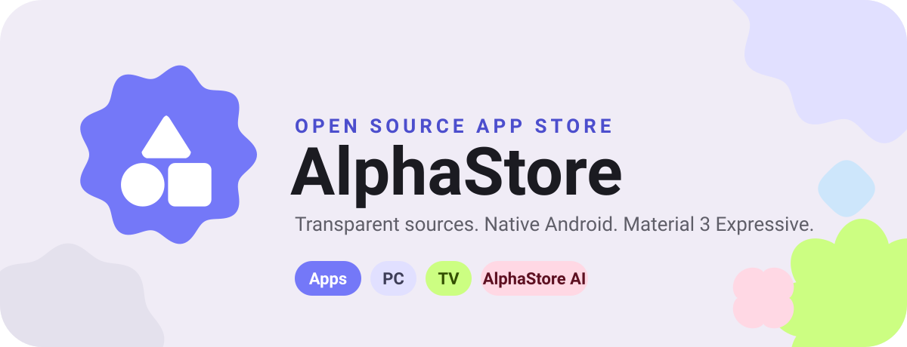

<p align="center">
  <picture>
    <source media="(prefers-color-scheme: dark)" srcset="assets/m3-hero-dark.svg">
    
  </picture>
</p>

<p align="center">
  <a href="https://github.com/RamonMods/AlphaStore/stargazers"></a>
  <a href="https://github.com/RamonMods/AlphaStore/network/members"></a>
  <a href="https://github.com/RamonMods/AlphaStore/releases"></a>
  <a href="https://github.com/RamonMods/AlphaStore/releases"></a>
</p>

<p align="center">
  Uma loja de apps transparente, feita em torno de releases públicas, metadados inspecionáveis e automação que dá para acompanhar.<br>
  <strong>Nativa. Em português. Do RamonMods.</strong>
</p>

<p align="center">
  <a href="https://pixgg.com/ramon" target="_blank"></a>
</p>

<p align="center">
  <strong>Fontes suportadas</strong><br>
  <a href="https://github.com"></a>
  <a href="https://gitlab.com"></a>
  <a href="https://codeberg.org"></a>
</p>

<p align="center">
  <picture>
    <source media="(prefers-color-scheme: dark)" srcset="assets/m3-divider-dark.svg">
    
  </picture>
</p>

## Visão geral

**AlphaStore** é um cliente de loja de apps para Android, focado em transparência. O app usa catálogo público em JSON, resolve releases do GitHub, GitLab e Codeberg e mantém o caminho de entrega compreensível — dá para ver de onde as coisas vêm e como as atualizações são descobertas.

Este repositório reúne o cliente e os dados do catálogo no mesmo lugar: `config.json`/`apps.json` ficam na branch `main`, e `mirror.json`/`stars.json`/sentinel ficam na branch `data`.

> AlphaStore é para quem se importa de onde o software vem, não só com a velocidade do download.

### Destaques

- **Catálogo público** — dados em JSON, configuração inspecionável.
- **Múltiplas fontes** — releases no GitHub, GitLab e Codeberg.
- **Instalação nativa** — instalar, atualizar e ferramentas de segurança no próprio app.
- **Instalação sem espera** — opção de instalação sem fio para evitar a espera de 24h do Android para apps não verificados.
- **Orbit** — acompanha apps pela página onde são publicados e instala o arquivo oferecido ali. Compatível com fluxos no estilo Obtainium (exportação/link `obtainium://`).
- **PT-BR e vários idiomas** — interface em português, com suporte a múltiplos idiomas.

## Privacidade e rastreadores

A AlphaStore não tem rastreadores de vigilância. Alguns scanners podem sinalizar componentes por nome por causa do Unity Ads SDK usado apenas na missão opcional “Fuel the Code”. O Unity só inicia quando você toca para assistir um vídeo recompensado; não roda na inicialização, não tem serviços em segundo plano, não usa ID de publicidade e a AlphaStore não coleta nem envia dados do usuário.

<p align="center">
  <picture>
    <source media="(prefers-color-scheme: dark)" srcset="assets/m3-divider-dark.svg">
    
  </picture>
</p>

## Stack técnica

| Camada | Tecnologia |
|---|---|
| UI | Jetpack Compose, Material 3 Expressive |
| Linguagem | Kotlin |
| Rede | OkHttp + kotlinx-serialization |
| Imagens | Coil 3 |
| Instalação privilegiada | Shizuku, Dhizuku, root, ADB sem fio |
| Anúncios opcionais | Unity Ads (recompensado, só quando o usuário inicia) |

## Download

Baixe o APK mais recente na página de [Releases](https://github.com/RamonMods/AlphaStore/releases).

## Construir o projeto

```bash
# Clone
git clone https://github.com/RamonMods/AlphaStore.git
cd AlphaStore

# Build debug (requer Android SDK / JDK configurados)
./gradlew :app:assembleDebug
```

No Windows:

```powershell
.\gradlew.bat :app:assembleDebug
```

> A validação oficial de build/teste Android neste projeto é feita via GitHub Actions.

## Estrutura do repositório

- `app/` — aplicativo Android nativo (Kotlin + Compose)
- `assets/` — imagens e artes do README/site
- `AlphaStore Legacy/` — legado web anterior (referência histórica)
- `.github/workflows/` — CI/CD e automações
- `config.json`, `apps.json` — catálogo/configuração (branch `main`)
- Branch `data` — mirrors, stars, leaderboard e sentinel

## Dados e catálogo

O catálogo fica no próprio repositório [RamonMods/AlphaStore](https://github.com/RamonMods/AlphaStore):

- **Branch `main`**: `config.json`, `apps.json`, `mirror_config.json`, `release_notes.json`
- **Branch `data`**: `mirror.json`, `stars.json`, `leaderboard.json`, `sentinel/`, `mirrors/`, `updates.bin`

Para mudar catálogo/fontes/mirrors, atualize os arquivos correspondentes e os endpoints em `app/src/main/java/com/ramonmods/alphastore/data/Models.kt` quando necessário.

## Contribuir

Pull requests são bem-vindos. Antes de abrir uma mudança grande, descreva o problema ou a proposta na issue/discussão para alinhar direção.

## Apoiar

Se a AlphaStore te ajuda, você pode apoiar o projeto via Pix:

**Pix:** [https://pixgg.com/ramon](https://pixgg.com/ramon)

## Licença

Este projeto é distribuído sob a licença **GPL-3.0**. Veja [LICENSE](LICENSE).
